---
search:
  boost: 2.5
---

# Access Requests

The **Access Request** feature in Actian Data Intelligence Platform is designed to simplify and streamline the process of requesting access to data assets and products within the  organization.
It allows users to request access to the data assets or data products they need directly through Explorer. Data owners can review these requests in Studio and trigger an external workflow to apply the appropriate permissions and grant access to the data.

## Key Benefits

The following are the key benefits of the **Access Request** feature:

* **Frictionless access**: End-users can easily request access to any dataset within the catalog without navigating complex processes across multiple tools.  
* **Approval workflow**: Requests are automatically routed to the appropriate data owner or administrator for review and approval in Studio, ensuring security and compliance are upheld.  
* **Audit trail**: Every request and access change is tracked, providing full visibility and traceability of data access across the organization.  
* **Empowered teams**: Enabling self-service access requests allows users to unlock data faster and maintain momentum without unnecessary delays.

This feature fosters a more collaborative and data-driven culture while upholding strong governance and security controls.

## Principles

The following scheme describes how access requests are handled in Actian Data Intelligence:

1. A data consumer writes an access request from the details page of an item in Explorer.  
2. Once the request is submitted, an email notification is automatically sent to the owner of the item for review.  
3. The data owner reviews the request in Studio and either approves or rejects it.  
4. After the review, an email notification is automatically sent to the requester with the status of their request. 
5. If the request is approved, a machine-readable email or an API request is sent to the external ticketing tool or workflow system to create a ticket or directly configure the necessary permissions.

  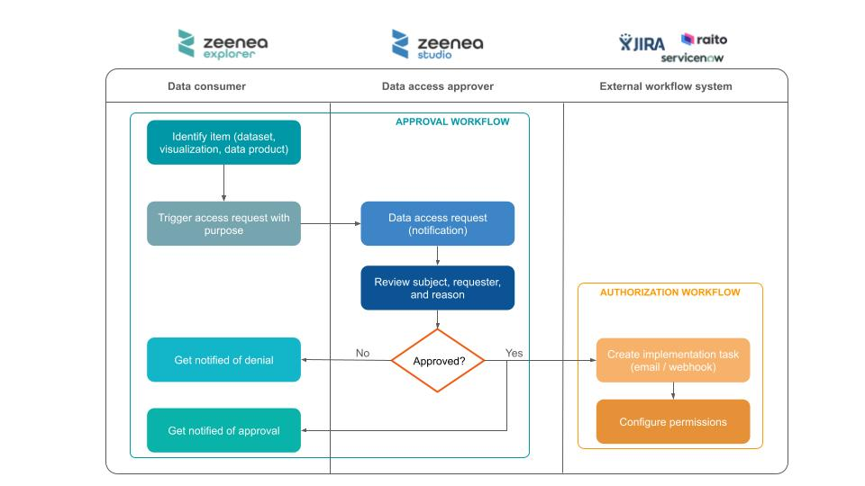

## Access Request Policy

Access requests in Actian Data Intelligence are managed through policies defined by administrators in the Actian Data Intelligence **Administration** interface. These policies specify rules for requesting access to data assets, including required attributes.
Data owners can define and manage access request policies in the Policies section. After a policy is created, it can be associated with individual data assets. Only items linked to a policy support access requests.
Data consumers can request access to a data asset only if an access request policy is associated with it.

### Access Duration

When creating an access request policy, administrators can configure whether requesters must specify how long they need access when submitting an access request. 

Depending on the policy configuration, requesters can request **Permanent** or **Temporary** access. 

The selected duration is displayed to approvers during the review process and included in configured mailhook and webhook notifications, providing external provisioning systems with information about the requested access period.

!!! note 
    Actian Data Intelligence Platform records and communicates the requested access duration but does not enforce it. Access is not automatically revoked when the duration ends. Your provisioning system or team is responsible for determining how the requested duration is applied.

### Create an Access Request Policy

You can create new access request policies in Actian Data Intelligence **Administration**.

**To create an access request policy**

1. Open **Administration**.
   
2. Go to the **Policies > Access requests** section.
   
3. Click the **Create policy** button.<br />The **Create an Access Request Policy** window opens. 
   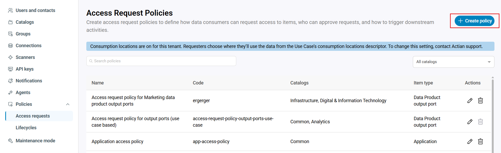
   
4. Complete the following fields:
    * In the **General information** section:
         * **Name** (required): Enter a unique name for the access request policy.
         * **Code** (required): Enter a unique identifier.
         * **Description**: Provide a brief explanation of the policy.
         * **Catalogs to which the policy applies** (required): Select the catalogs from the drop-down list. You can select multiple catalogs.
         * **Automatically apply on new catalogs**: Toggle to automatically apply the policy to new catalogs.
         * **Item type to which policy applies** (required): Select the item types for which you want to enable the policy: 
             * Datasets
             * Visualizations
             * Data products
             * All custom item types
      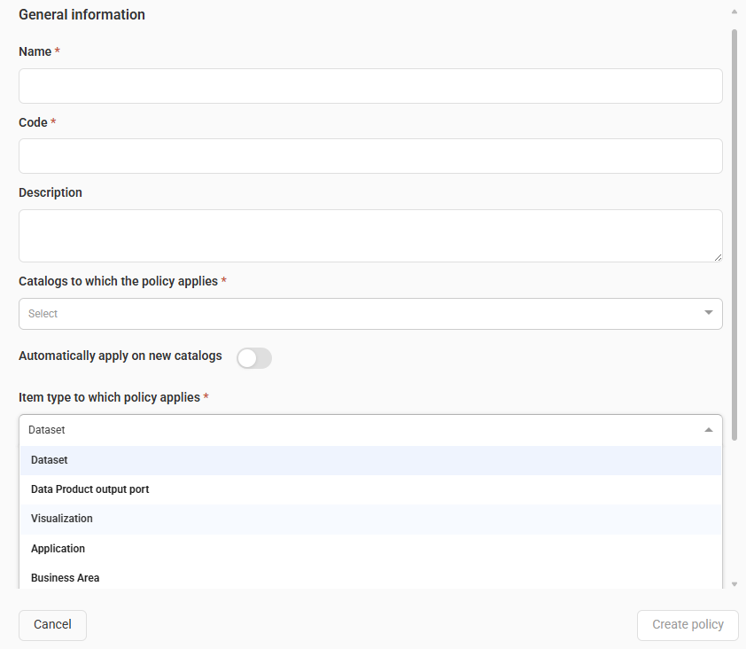
    
    * In the **Approval workflow** section:
         
         * **Format of the request reason** (required): Select one of the following formats:
             
             * **Free text**: Type the reason for the request manually.
             
             * **Select a use case**: Choose from a predefined list of use cases.
             
            !!! note
                A **Use case** is a built-in item type. By documenting use cases in the catalog, curators can provide more context for data owners when reviewing access requests and automate the setup of user permissions.

         * **Extra field from use case template**: The field appears when you select **Select a use case**. Select a property from the available **Multi-select** or **Tag** type properties in the Use case item type template. For more information, see [Extra Field from Use Case Template](#extra-field-from-use-case-template).
          
         * **Approvers** (required): Select the roles responsible for approving access requests.
         
         * **Ask requesters for an access duration**: Select this option to require requesters to specify how long they need access when submitting an access request. This option is disabled by default. For more information about access duration, see [Access Duration](#access-duration).
      
      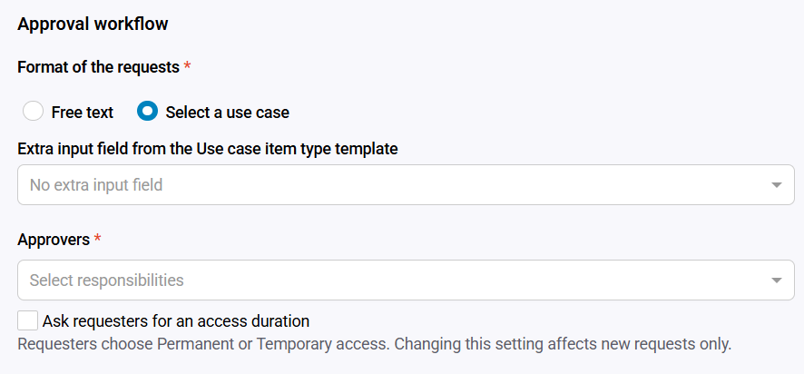
    
    * In the **Mailhook and webhook** section:
         
         * **Hook type**: Select one of the following types from the drop-down list:
             
             * **No external workflow**: No external actions (such as sending an email or calling a webhook) are triggered when an access request is approved. In this case, you must manually grant the required permissions in the source system.
             
             * **Email**: For more information about configuration, see [Configure the Email Channel for the Authorization Workflow](#configure-the-email-channel-for-the-authorization-workflow-mailhook).
             
             * **Webhook**: For more information about configuration, see [Configure the Webhook Channel for the Authorization Workflow](#configure-the-webhook-channel-for-the-authorization-workflow).
         
         * **Select statuses**: When you activate a mailhook or webhook, select the events you want to receive:
            
            * Pending
            
            * Rejected
            
            * Approved
        
        !!! note 
            The payload format is the same for all messages.      
      
       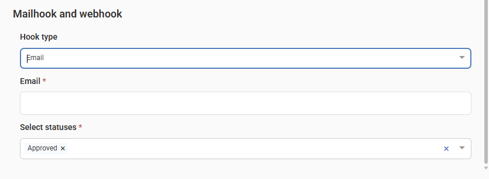
              
5. Click **Create policy**.<br />A new access request policy is created.
 
### Edit an Access Request Policy

You can edit the access request policies in Actian Data Intelligence **Administration**.

**To edit an access request policy**

1. Open **Administration**.
2. Go to the **Policies** section.
3. Click the **Edit the Access Request policy** button in the **Actions** column.<br />An **Update an Access Request Policy** window opens.
4. Make the required changes to the policy attributes.
5. Click **Update policy**.
   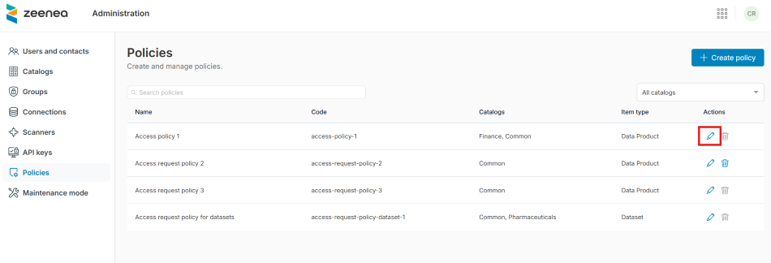

!!! note
    Changes to the **Ask requesters for an access duration** setting apply only to new access requests. Existing requests retain their original access duration information, if any.
    
### Delete an Access Request Policy

You can delete an access request policy only if it is not linked to any items.

**To delete an access request policy**

1. Open **Administration**.
2. Go to the **Policies** section. 
3. Click the **Delete policy** button in the Actions column.<br />A **Delete policy** dialog opens.
4. Click **Confirm**.
   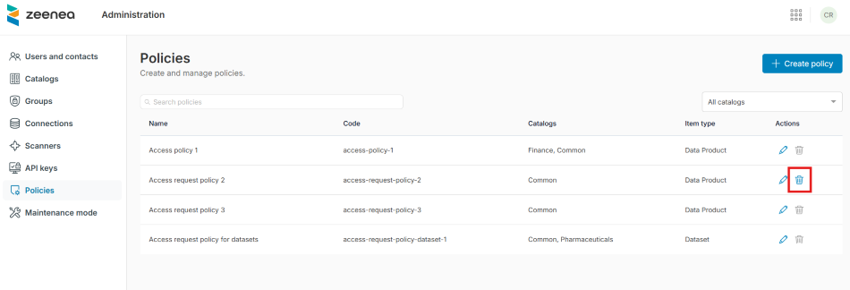

### Extra Field from Use Case Template

When you select the **Select a use case** format, the **Extra field from use case template** field appears. This field allows you to select a property from the available **Multi-select** or **Tag** type properties in the Use case item type template (as defined in the **Catalog design** section).
When a property is selected, the access request form updates so requesters can use this parameter to refine their request.


For example, you can use this option to manage access requests for user groups instead of individual users:

1.	Assign user groups to each use case using a multi-select property.
2.	When requesting access, the end user can select the user group for which they are requesting access.
3.	This information is displayed to the data owner for review and then forwarded to the source system or IT department through the configured mailhook or webhook.

### Configure the Email Channel for the Authorization Workflow (Mailhook)

When you activate the External workflow type and select Email, you must provide the following field:

* **Email**: Enter the email address that receives automatic notifications after each access request is approved in Studio.

The email is formatted in `XML` so ticketing or workflow management tools, such as Jira or ServiceNow, can automatically parse it.

If the request includes an access duration, the email notification includes the duration information described in [Access Duration in Notifications](#access-duration-in-notifications).

Authorization request email example with extra input field activated:

**Object**: \[Zeenea\] Data Access Request on Item ABCD  
**Content**:

```xml
<?xml version="1.0" encoding="UTF-8"?>
<dataAccessRequest>
    <requester>johndoe@acme.com</requester>
    <approver>janesmith@acme.com</approver>
    <accessRequestKey>123</accessRequestKey>
    <policyCode>access-policy-1</policyCode>
    <status>Approved</status>
    <timestamp>2025-11-04T09:51:44.215886Z</timestamp>
    <subject>
        <technicalName>customer-profile</technicalName>         
        <url>https://acme.zeenea.app/studio/permalink?uuid&#61;0fc7e9a4-034a-4845-898f-fa8cd48fd172&amp;nature&#61;data-product-output-port</url>
        <key>API/customer/customer-profile</key>
        <summary>Customer profile information.</summary>
        <responsibilities>
                <responsibility>
                    <label>Curator</label>
                    <code>curator</code>
                    <userEmail>janesmith@acme.com</userEmail>
                </responsibility>
        </responsibilities>
        <properties>
                <property>
                    <label>Personally Identifiable Information</label>
                    <code>$z_personally-identifiable-information</code>
                    <values><value>No</value></values>
                </property>
        </properties>
    </subject>
    <audience></audience>
    <purpose><![CDATA[Analyse customer behavior.]]></purpose>
        <useCase>
            <name>Churn Risk Analysis</name>
            <key>use-case/Churn Risk Analysis</key>
            <summary>The analytics team wants to model customer churn risk by combining behavioral signals like last purchase date and declining engagement trends across channels.</summary>
            <responsibilities>
                    <responsibility>
                        <name>Curator</name>
                        <code>curator</code>
                        <userEmail>haroldjames@acme.com</userEmail>
                    </responsibility>
            </responsibilities>
            <properties>
                    <property>
                        <label>Contributors</label>
                        <code>contributors</code>
                        <values>
                                <value>Group A</value>
                                <value>Group B</value>
                        </values>
                    </property>
            </properties>
        </useCase>
    <extraInformation>
           <name>Contributors</label>
           <code>contributors</code>
           <values>
              <value>Group A</value>
           </values>
    </extraInformation>
</dataAccessRequest>
```

You can configure your workflow management tool to parse this email, extract the relevant information, and create a ticket to assign the correct permissions to the user.

### Configure the Webhook Channel for the Authorization Workflow

When you activate the External workflow type and select Webhook, you must provide the following fields:

* **Webhook URL**: Enter the endpoint URL that your system exposes to receive access request notifications.  
* **Secret key**: Enter a string of up to 4096 characters to sign the messages sent to the webhook.

If the request includes an access duration, the webhook payload includes the optional `accessDuration` object described in [Access Duration in Notifications](#access-duration-in-notifications).

To manage access request notifications, your system must expose an HTTPS REST API endpoint. After each access request approval, the Actian Data Intelligence sends `POST` messages secured with HMAC (Hash-based Message Authentication Code) to notify the webhook.  
   
HMAC works as follows:

1. For webhook requests, the provider signs the message using the secret key and the HMAC-SHA256 hashing algorithm, encodes the resulting signature in hex, and then includes it in the request header.  
2. The webhook listener receives the request and repeats the steps: signs and encodes the message using the secret key, then compares the resulting signature with the value sent in the request header. If they match, the request is legitimate.

The Actian Data Intelligence also provides a timestamp (`X-TIMESTAMP` parameter) in the request header to prevent malicious users from replaying the message.  
   
The request signature is provided in the `X-HUB-SIGNATURE-256` header, which is generated by encoding `secret+timestamp+payload` in that order.  

!!! warning "Important"
    The platform makes a single call to the webhook and does not retry if the request returns an error or the endpoint is unavailable.


Request payload example with extra input field activated:

```json
{
  "webhookVersion": "1.0",
  "requesterEmail": "johndoe@acme.com",
  "timestamp": "2025-11-04T09:51:44.215886Z",
  "policyCode": "access-policy-1",
  "status": "Approved",
  "approverEmail": "janesmith@acme.com",
  "reasonFreeText": "Analyse customer behavior.",
  "reasonUseCase": {
    "name": "Churn Risk Analysis",
    "key": "use-case/Churn Risk Analysis",
    "summary": "The analytics team wants to model customer churn risk by combining   behavioral signals like last purchase date and declining engagement trends across channels.",
    "properties": [
      {
        "code": "contributors",
        "label": "Contributors",
        "value": [
          "Group A",
          "Group B"
        ]
      }
    ],
    "responsibilities": [
      {
        "roleName": "Curator",
        "roleCode": "curator",
        "userEmail": "haroldjames@acme.com"
      }
    ]
  },
  "reasonUseCaseExtraInformation": {
    "propertyName": "Contributors",
    "propertyCode": "contributors",
    "propertyValues": [
      "Group A"
    ]
  },
  "itemInfo": {
    "technicalName": "customer-profile",
    "key": "API/customer/customer-profile",
    "name": "Customer Profile",
    "url": "https://acme.zeenea.app/studio/permalink?uuid&#61;0fc7e9a4-034a-4845-898f-fa8cd48fd172&amp;nature&#61;data-product-output-port",
    "summary": "Customer profile information.",
    "properties": [
      {
        "code": "$z_personally-identifiable-information",
        "label": "Personally Identifiable Information",
        "value": [No]
      }
     ]
  },
  "accessRequestKey": "123"
}
```

The following is a sample of Node.js code to check the messages:

```javascript
const signatureHeader = 'X-HUB-SIGNATURE-256'
const signatureAlgorithm = 'sha256'
const encodeFormat = 'hex'
const hmacSecret = 'secret'
const timestampHeader = 'X-TIMESTAMP'


app.post('/webhook', (req, res) => {
  // Get hash sent by the provider
  const providerSig = Buffer.from(req.get(signatureHeader) || '', 'utf-8')
  // Create digest with payload + hmac secret
  const hashPayload = req.rawBody
  const timestamp = req.get(timestampHeader)
  const hmac = crypto.createHmac(signatureAlgorithm, hmacSecret)

  const hmacWithTimestampAndHashPayload = hmac.update(timestamp.toString(), 'utf-8').update(hashPayload, 'utf-8');

  const digest = Buffer.from(hmacWithTimestampAndHashPayload.digest(encodeFormat), 'utf-8')

  // Compare digest signature with signature sent by provider
  if (providerSig.length !== digest.length || !crypto.timingSafeEqual(digest, providerSig)) {
    res.status(401).send('Unauthorized')
  }else{
    // Webhook Authenticated
    // process and respond...
    res.json({ message: "Success" })
  }
})
```

### Access Duration in Notifications

Configured mailhook and webhook notifications include the access duration exactly as selected by the requester. The optional `accessDuration` object is present in notifications for requests that include a duration and omitted when no duration was specified.

The webhook payload version remains unchanged (`"webhookVersion": "1.0"`). The `accessDuration` object is added to the existing payload and does not introduce a new webhook version.

The following examples show how access duration is represented in notifications.

**Permanent access**

Access without a predefined end date.

```json
{
  "accessDuration": {
    "type": "permanent"
  }
}
```

**Temporary access with a preset duration**

Access for a predefined period. The `duration` field uses an ISO 8601 duration value, such as `P1D` (1 day), `P1W` (1 week), `P2W` (2 weeks), `P1M` (1 month), `P6M` (6 months), or `P1Y` (1 year).

```json
{
  "accessDuration": {
    "type": "temporaryPreset",
    "duration": "P1W"
  }
}
```

**Temporary access with custom dates**

Access for a specific period defined by a start date and an end date. Both dates use the `yyyy-MM-dd` format and do not include a time or time zone.

```json
{
  "accessDuration": {
    "type": "temporaryRange",
    "startDate": "2027-01-12",
    "endDate": "2027-02-15"
  }
}
```

When processing notifications:

* Treat a missing `accessDuration` as **no duration specified**, not as **Permanent**.
* For preset durations, the provisioning system determines when access starts and ends. The platform does not interpret the preset or assign a start date.
* Ignore unknown fields so that future payload additions do not break your integration.

## Activate Access Request on an Item

When access request policies are enabled for an item type, curators can activate the feature from an item details page. You must have write permissions on the item to activate access request.

**To activate access request**

1. In Studio, open the item details page.
2. In the **General** tab, select the required policy from the **ACCESS REQUEST POLICY** drop-down list.<br />A **Set an access request policy** dialog opens.
3. Click **Confirm**. 
   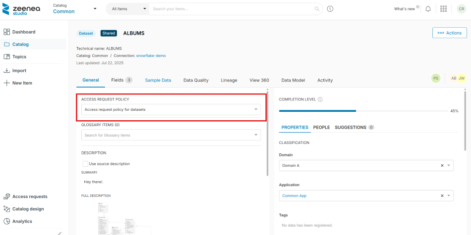

### Deactivate Access Request

Make sure there are no pending access requests for the item before deactivating the policy. Once the policy is deactivated, pending access requests remain, but the authorization workflow (such as email notifications or webhook calls) will not be triggered.

**To deactivate access request**

1. In Studio, open the item details page.
2. In the General tab, select **No access request policy** from the **ACCESS REQUEST POLICY** drop-down list.<br />A **Remove the access request policy** dialog opens.
3. Click **Confirm**.
   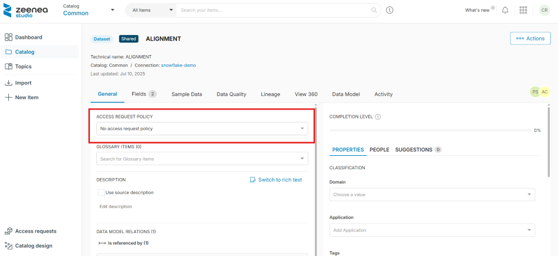
    
Note that at least one contact assigned to the item must have access to the Studio to make the feature available in the Explorer. This ensures at least one person can review the access requests for this item.

## Submit Access Request on an Item

When the feature is activated for an item, you can request access from the item details page in Explorer.

**To submit an access request**

1. In Explorer, go to the item details page.
2. Click the **Request Access** button on the top right.<br />A **Create a new access request** dialog opens.
3. Provide the following information:
     * If the **Use case** field is displayed:
         * **Use Case** (required): Select the use case from the drop-down list.
         * If an extra input field is configured (for example, **User group**) (required): Select the necessary values from the multi-select list.
         * **Reason** (optional): Enter the reason or project for which you need access to the data. 
         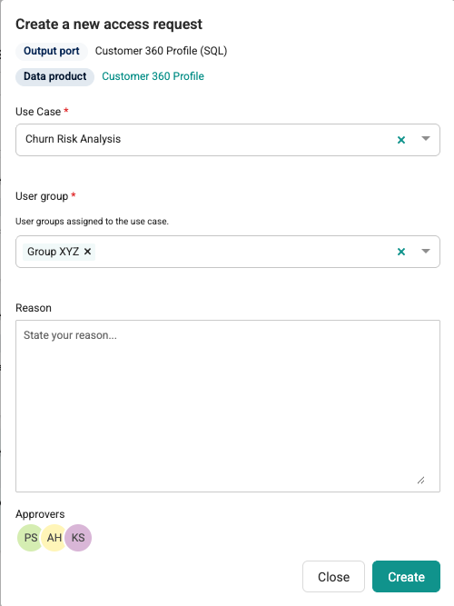
     * If the **Use case** field is not displayed:
         * **Reason** (required): Enter the reason or project for which you need access to the data.
         * **Audience** (required): Select for whom you are requesting access (Myself or Service account). 
         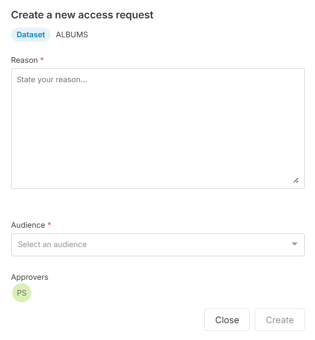
4. If the policy requires an access duration, select **Permanent** or **Temporary** in the **Access duration** section. <br />For temporary access, choose one of the following options:
     
     * **A preset duration**: 1 day, 1 week, 2 weeks, 1 month, 6 months, or 1 year.
        
        !!! note
            A preset duration defines a length of time, not a calendar period, and does not include a start date. Your provisioning system determines when the period starts based on when access is granted.
     
     * **Custom dates**: Select a start date and an end date from the calendar, or enter the dates manually.
          
        !!! note
            For custom dates:
              
            * The start date cannot be in the past.
            * The end date cannot be before the start date.
            * A date range that starts and ends on the same day is valid.
            * Dates are calendar days and do not include a time or time zone.
         
        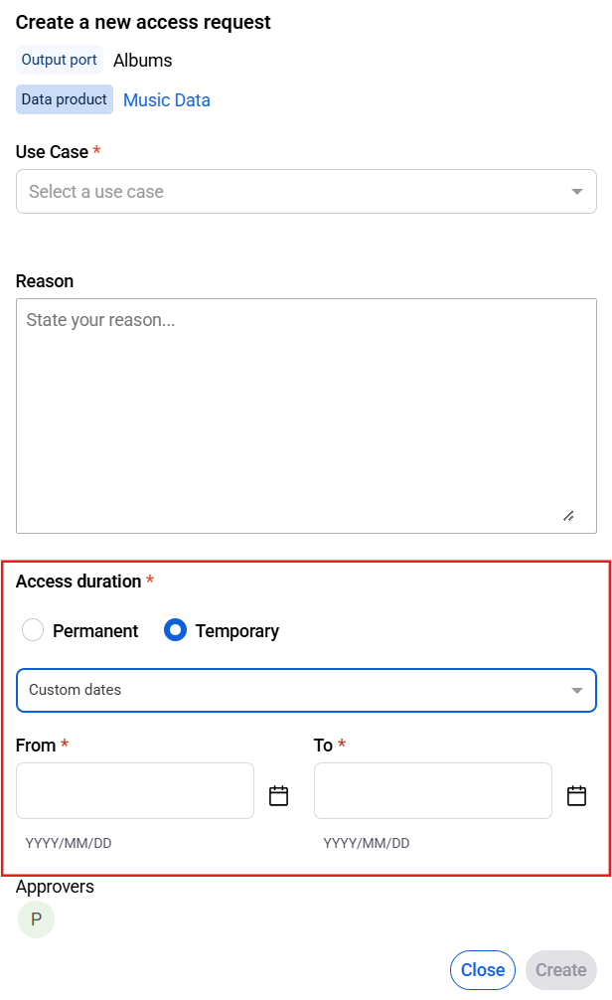

5. Click **Create**.

Once the request is submitted, the approver receives an email notification to invite them to review it. After the review, you will receive an email notification with the status of your request (approved or rejected) and an optional comment from the approver.

## Manage Pending Access Requests

### List Pending Data Access Requests

You can retrieve the list of your pending data access requests in Explorer.

**To view the list of pending data access requests**

1. Open Explorer.
2. Click the **Access requests** button in the upper-right corner of the Explorer header.<br />The **Access requests** window opens, displaying the list of pending access requests.
   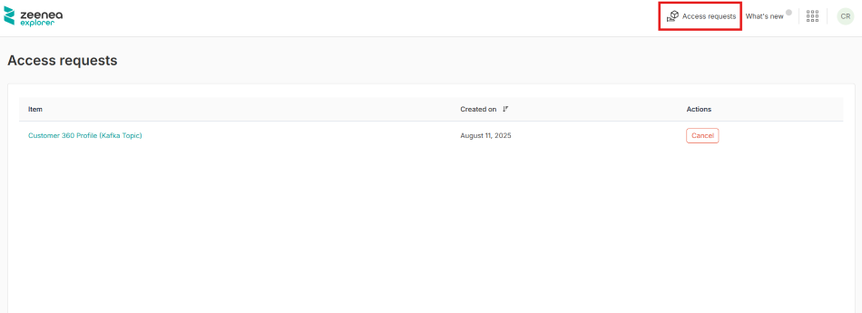

### Cancel Data Access Request

You can cancel your pending data access request in Explorer.

**To cancel the data access request**

1. Open Explorer.
2. Click the **Access requests** button in the upper-right corner of the Explorer header.
3. Click the **Cancel** button in the **Actions** column.<br />A **Cancel the access request** dialog opens.
4. Click **Confirm**. 
   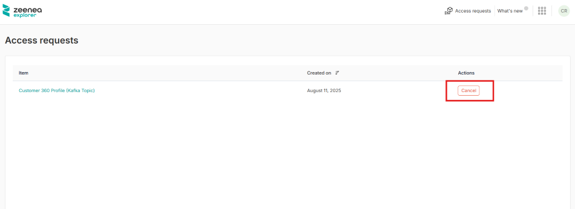
 
When cancelled, the request is removed from the list of pending requests for the approver.

## View the Status of an Access Request

You can view the current status of an access request in both Studio and Explorer.
The possible statuses are:

* **Pending**: The request is awaiting review by the data owner.
* **Approved**: The request has been approved, but the access has not yet been granted.
* **Rejected**: The request has been rejected by the data owner.
* **Granted**: Access has been granted in the source system.
* **Error**: An error occurred during the process of granting access.
* **Closed**: The request has been cancelled by the requester.

### View the Status in Studio

In Studio, the data owner can view the current status and all status change activities of an access request.

**To View the status details**

1. Open Studio.
2. Go to the **Access requests** section.<br />The **Access requests** window opens, displaying the list of access requests.
3. Click an access request from the list.<br />The **Access Request Details** side panel opens, displaying the request's current **Status** and **Activity** history, including any comments.  
   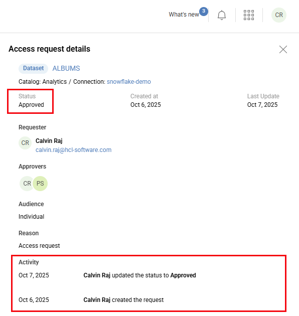

### View the Status in Explorer

In Explorer, the data requester can view the current status and all status change activities of an access request.

**To View the status details**

1. Open Explorer.
2. Click the **Access requests** button in the upper-right corner of the Explorer header.
3. Click an access request from the list.<br />The **Access Request Details** side panel opens, displaying the request's current **Status** and **Activity** history, including any comments.  
   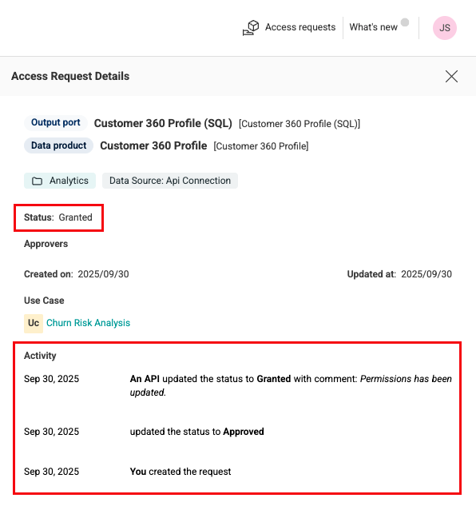

### Access Duration in Request Details

The access request details in Explorer and Studio display the access duration selected by the requester. This information is read-only for both requesters and approvers.

The following access duration values can be displayed:

* **Permanent**: Access with no end date was requested.
* **Temporary** with a preset duration, such as **1 week**: Access for the selected duration was requested.
* **Temporary** with custom start and end dates: Access for the specified date range was requested.
* **No Access duration row**: The request was created when the policy option was disabled. No duration was specified. This does not indicate permanent access.

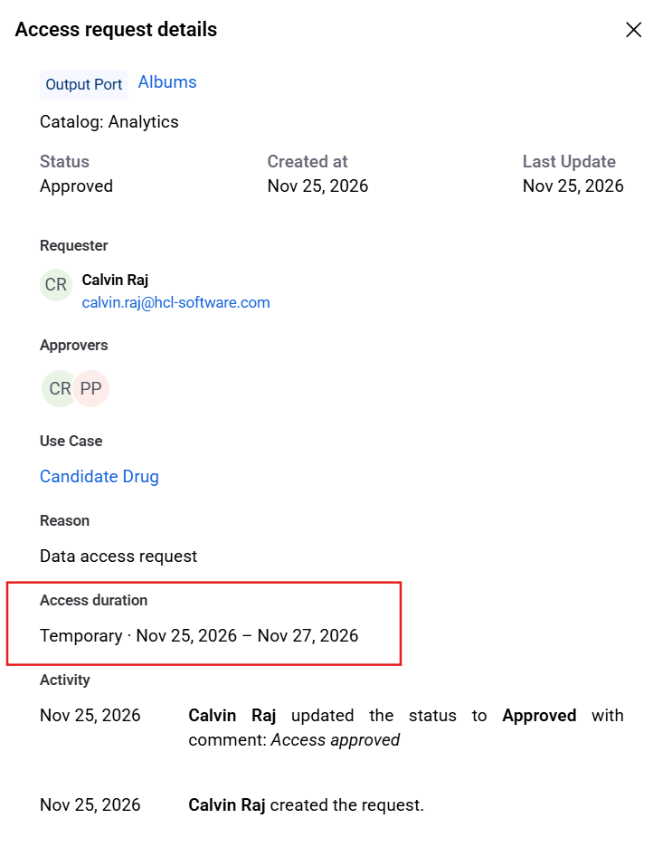

## Review Access Requests

You can manage the access requests assigned to you from the **Access requests** section in the Studio.

**To review the access requests**

1. Open Studio.
2. Go to the **Access requests** section.<br />An **Access requests** window opens, displaying the list if pending access requests assigned to you.
     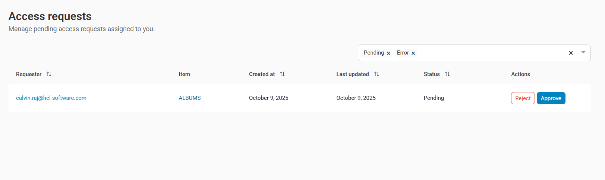
3. Select an access request to open a side panel with more details.
     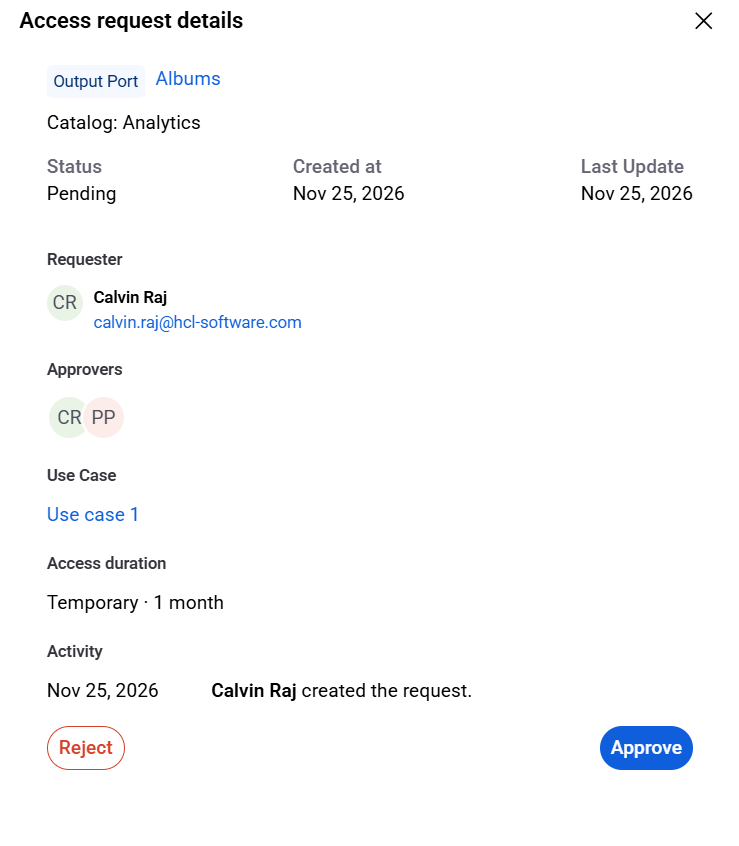
4. Review the request details.
5. Review the requested **Access duration**, if displayed.
    
    !!! note
        Approvers cannot change the duration. If a different duration is required, reject the request and ask the requester to submit a new request.

6. After reviewing the details, click **Approve** or **Reject**.<br />An **Approve the access request** or **Reject the access request** dialog opens.
   
    !!! note
        In both cases, you can add a comment.

7. Click **Confirm**.
8. If the External workflow type option is activated in Administration, Studio automatically sends an email to the specified email or calls the webhook when a request is approved.

## Audit Access Requests

### Audit Access Request Configuration Changes

The configuration changes regarding data access requests are traced in the audit log. You can list audit events using the Audit API.

### Audit Access Request Changes

The data access requests and their processing are recorded in the audit log. You can list audit events using the Audit API.

For more information about Audit API, see [Audit Trail API](../../technical-documentation/api/audit-trail-apis.md).

## Limitations

### Access Duration

* Access durations are informational only and are not enforced by the platform. Your provisioning system or team is responsible for granting and revoking access in the source system.
* When the requested duration ends, the request status does not change. For example, an **Approved** request remains **Approved**. There is no **Expired** status, automatic expiration scheduler, or additional notification when the duration ends.
* Extensions and renewals are not supported. Submit a new access request instead.
* Maximum duration limits cannot be configured per policy.
* Access requests with an access duration can be created only from Explorer, not through the Access Request API.
