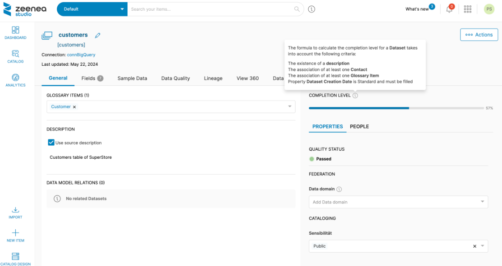

# Documentation Completion Level

Actian Data Intelligence provides a graphical indicator that shows the level of documentation completion at a given point in time.

The completion level is calculated for each Item and is displayed in search results and on the Item details page.

## How the Documentation Completion Level Is Calculated

  

The documentation completion level is also calculated for the perimeter of a Curator (that is, all the Items assigned to it) by Item Type. You can view the completion level on the Dashboard.

The completion level calculation is based on the following four criteria:

* Is the description filled in?
* Has at least one contact been added?
* Has at least one Glossary Item been linked? This criterion is ignored if the metamodel does not support this type of link.
* Are all the **Standard** and **Important** properties filled in? 

**Important** properties carry twice the weight of **Standard** properties in the completion level calculation.

Descriptions imported from the source are also taken into account in the calculation of the completion level.

When the metamodel is updated, for example, when a property is removed from the template, the completion level is recalculated automatically. This is an asynchronous task and can take several minutes.

An administrator can define which properties are **Standard** or **Important** in the Catalog Design section. You can find this information in the tooltip on each Item's details page.

