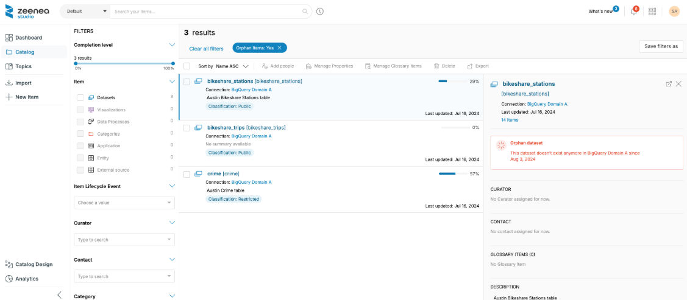
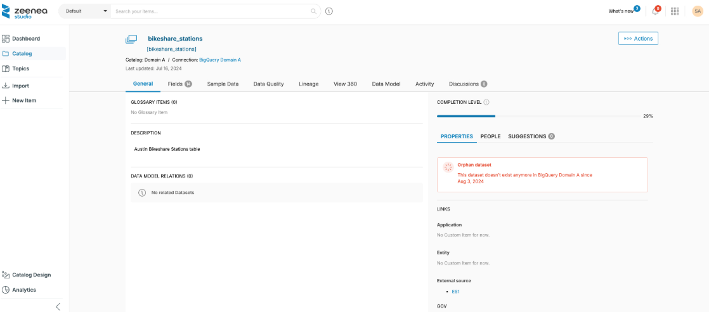

# Identifying Orphan Items

At each inventory of a connection, Actian Data Intelligence checks the status of each item imported into the catalog. An item can then become an orphan.

For more information about orphan items, see [Orphan Item](../../../getting-started/definitions.md#orphan-item)

## Item Notifications

If an item is no longer present in the inventory provided by the connection, an insert in red appears, indicating the date of the first inventory from which the item was made an orphan.

The latter is identified at different levels:

On the overview in the search:

  

On its detailed page:

  

## Deleting Orphan Items

The integration of its documentation will be removed from the catalog for all users.

* The **Yes** button on the red inserts allows you to delete the item and its fields directly from its overview.
* The trash can button at the top right of its detailed page also allows you to delete it.

## From the Search

You can also use the "Orphan Items" filter from the Catalog section of Studio to quickly identify orphan items.
